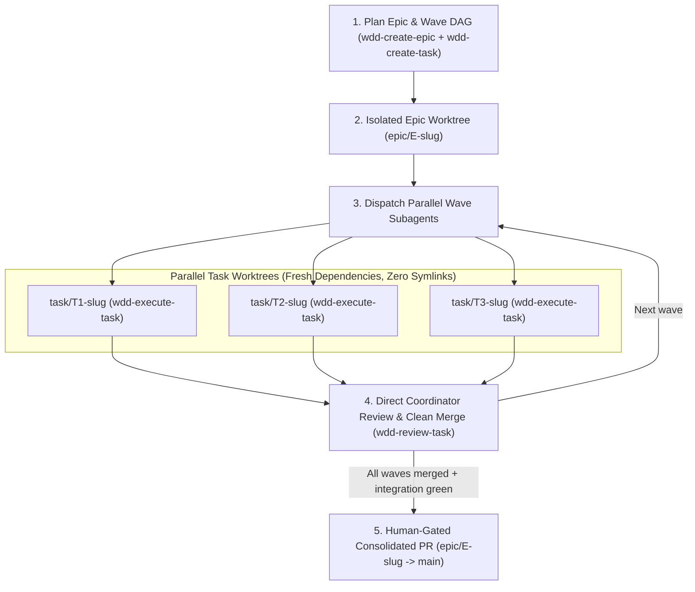

# Workflow-Driven Development (WDD)

[](https://github.com/GuilhermeTome/workflow-driven-development/actions/workflows/ci.yml)
[](./LICENSE)

Turn GitHub Epics into zero-conflict parallel subagent waves inside isolated `git worktree` sandboxes, delivered as a single human-gated Pull Request.

---

## Why Workflow-Driven Development?

Scaling AI coding agents beyond trivial edits usually breaks down at two extremes:

- **Single-agent sequential sessions** suffer from $O(N)$ serial execution and **context window rot**—as stale file reads, compiler output, and earlier tasks accumulate, adherence to repository rules (`AGENTS.md` / `CLAUDE.md`) degrades.
- **Uncoordinated multi-agent swarms** collide on shared route registries, models, and barrel exports, corrupt shared `node_modules/` or `vendor/` caches during concurrent codegen, leave orphaned branches behind, or ship half-finished waves prematurely to `main`.

**Workflow-Driven Development (WDD)** solves both problems with a deterministic, harness-agnostic coordination protocol: freeze shared contracts upfront in GitHub Issues, partition tasks into mathematically disjoint **File Isolation Waves**, execute every task in an ephemeral `git worktree` with fresh dependencies, gate merges through a 3-lens Coordinator diff review, and open **one consolidated PR** targeting `main`.

- Deep dive into the failure modes, 7 invariants, and topologies: [**Principles of Workflow-Driven Development**](./docs/principles.md)
- Trace a realistic 2-wave Epic from first prompt to final PR: [**End-to-End Architecture Walkthrough**](./docs/architecture-walkthrough.md)

---

## Architecture & Lifecycle



1. **Plan Epic & Wave DAG:** [`wdd-create-epic`](./skills/wdd-create-epic/SKILL.md) inspects the codebase, freezes shared DTO/API/SQL contracts, verifies zero file overlap within each wave, and batch-creates self-contained child issues via [`wdd-create-task`](./skills/wdd-create-task/SKILL.md).
2. **Isolated Epic Worktree:** [`wdd-run-epic`](./skills/wdd-run-epic/SKILL.md) creates a dedicated sibling checkout (`<parent>/.worktrees/<repo>/epic-<id>-<slug>`) on branch `epic/<id>-<slug>` via [`wdd-worktree.sh`](./skills/wdd-run-epic/scripts/wdd-worktree.sh)—leaving your primary working directory untouched.
3. **Parallel Task Worktrees:** For each wave, isolated `task/<id>-<slug>` worktrees fork from `epic/<id>-<slug>`. Concurrent subagents run [`wdd-execute-task`](./skills/wdd-execute-task/SKILL.md) with clean per-worktree dependency installs, strict file-boundary enforcement, automated tests, and Conventional Commits.
4. **Direct Coordinator Review & Clean Merge:** [`wdd-review-task`](./skills/wdd-review-task/SKILL.md) audits each task diff across three lenses (spec completeness, wave file isolation, and `AGENTS.md` compliance), dispatches up to 3 scoped fix rounds if needed, merges `--no-ff` into `epic/<id>-<slug>`, and immediately deletes temporary task worktrees and branches.
5. **Human-Gated Consolidated PR:** After all waves pass a whole-epic integration check, WDD opens a single Pull Request to `main` (`Closes #<epic>` + `Closes #<tasks>`) and hands the final merge decision to a human maintainer.

---

## The 5 Skills

| Skill | Slash / Trigger Usage | Role | Description |
| :--- | :--- | :--- | :--- |
| [`wdd-create-epic`](./skills/wdd-create-epic/SKILL.md) | `/wdd-create-epic <goal>` | Architect | Maps affected code, freezes shared contracts, partitions work into zero-overlap waves, publishes the GitHub Epic, and batch-creates linked Task issues (single-repo or cross-repo). |
| [`wdd-create-task`](./skills/wdd-create-task/SKILL.md) | `/wdd-create-task <scope>` | Architect | Authors a 100% self-contained GitHub Task issue with allowed files, parallel-wave exclusion rules, prescriptive contracts, and mandatory tests (batch or standalone). |
| [`wdd-run-epic`](./skills/wdd-run-epic/SKILL.md) | `/wdd-run-epic #<epic-id>` | Coordinator | Orchestrates an Epic across waves in `epic/<id>-<slug>`, dispatches parallel subagents, tracks crash-resilient state in `.wdd/state.md`, and opens one consolidated PR per repo. |
| [`wdd-execute-task`](./skills/wdd-execute-task/SKILL.md) | `/wdd-execute-task #<task-id>` | Subagent Implementer | Implements one Task issue inside an isolated `task/<id>-<slug>` worktree with fresh dependencies, `AGENTS.md`/`CLAUDE.md` compliance, full verification, and clean commits. |
| [`wdd-review-task`](./skills/wdd-review-task/SKILL.md) | `/wdd-review-task #<task-id>` | Coordinator Reviewer | Reviews a task diff directly against the issue spec and repository rules, runs up to 3 scoped fix rounds, and cleanly merges into `epic/*` (or opens a standalone PR to `main`). |

---

## Quick Installation (Multi-Harness)

**Prerequisites:** `git >= 2.30`, `gh >= 2.0` (authenticated via `gh auth login`), and `bash >= 4.0`.

### Option A — Via `skills` CLI

```bash
# Global install across detected harnesses
npx skills add GuilhermeTome/workflow-driven-development -g

# Or project-local install inside the current repository
npx skills add GuilhermeTome/workflow-driven-development
```

### Option B — Clone + Zero-Dependency Installer ([`scripts/install.sh`](./scripts/install.sh))

Installs canonical symlinks into `~/.agents/skills` and links **Claude Code** (`~/.claude/skills`), **Google Antigravity / Gemini CLI** (`~/.gemini/config/skills`), **OpenAI Codex** (`~/.codex/skills`), and **OpenCode** (`~/.config/opencode/skills`), or installs directly into a project-local `.agents/skills` directory:

```bash
git clone https://github.com/GuilhermeTome/workflow-driven-development.git ~/.local/share/workflow-driven-development
cd ~/.local/share/workflow-driven-development

# Install globally across all supported harnesses (or pass --claude, --gemini, --codex, --opencode)
bash scripts/install.sh --all

# Verify installation health
bash scripts/install.sh --check

# Optional: copy into a project-local .agents/skills directory for team repositories
bash scripts/install.sh --target /path/to/your-project/.agents/skills --copy
```

To cleanly remove WDD without touching third-party skills, run [`scripts/uninstall.sh`](./scripts/uninstall.sh) (`bash scripts/uninstall.sh --all`). For per-harness flags, macOS Bash notes, and manual symlink snippets, see the [**Multi-Harness Installation & Quickstart Manual**](./docs/installation.md).

---

## Quickstart Usage

### 1. Multi-Wave Epic Workflow (3+ Tasks or Cross-Layer Features)

```text
# Step 1 — Plan the architecture, Wave DAG, and GitHub issues
/wdd-create-epic Plan and publish an Epic for outbound webhook HMAC-SHA256 signing, exponential backoff retries, and a delivery replay UI.

# Step 2 — Execute all waves autonomously in isolated git worktrees and open 1 consolidated PR
/wdd-run-epic #42
```

### 2. Standalone Single-Task Workflow (Focused Bug Fix or Small Slice)

```text
# Step 1 — Author a self-contained Task issue with explicit file boundaries and tests
/wdd-create-task Fix race condition in token refresh middleware and add concurrent request regression tests.

# Step 2 — Implement and verify inside an isolated task/77-slug worktree branched from origin/main
/wdd-execute-task #77

# Step 3 — Run the 3-lens diff gate, clean up the local worktree, and open a PR to main
/wdd-review-task #77
```

### 3. Bonus: Multi-Agent IDE Orchestration (e.g., Orca)

Inside multi-agent IDEs like **Orca**, you can delegate an entire Epic (`wdd-run-epic`) to a dedicated IDE worktree tab so your main chat stays completely free:

- **Option 1 — Supervised Worker with Automatic PR Callback (`orchestration`):**
  ```text
  /orchestration open a new worktree with claude to execute Epic #42 using wdd-run-epic with parallel native subagents per wave, and report back with the final PR URL when done.
  ```
- **Option 2 — Independent Fire-and-Forget Worktree Tab (`orca worktree create`):**
  ```bash
  orca worktree create --name "epic-42" --branch "epic/42-webhook-reliability" --base-branch "origin/main" --no-parent --agent claude --prompt "Use wdd-run-epic (with native subagents per wave) to execute Epic #42 end-to-end and open the consolidated PR against main." --activate --json
  ```

See the full architecture diagram, CLI flags, and subagent authorization notes in [**Bonus: Orchestrating WDD Inside Multi-Agent IDEs (Orca)**](./docs/installation.md).

---

## Core Invariants

- **Zero File Overlap per Wave:** Tasks scheduled in the same `(Wave, Repository)` pair own strictly disjoint file sets; shared contracts or schemas land in an earlier foundational wave.
- **Dedicated `epic/<id>-<slug>` Branch:** Intermediate wave tasks merge (`--no-ff`) into `epic/<id>-<slug>` so `main` stays untouched and deploy-safe until the entire Epic is verified.
- **Fresh Per-Worktree Dependencies:** Every task worktree installs its dependencies from scratch—never symlinking `node_modules/`, `vendor/`, or `.venv/` across concurrent workers.
- **Direct Diff Review + 3-Round Fix Cap:** Coordinators audit `git diff` directly across spec, isolation, and `AGENTS.md` lenses, dispatching at most 3 scoped fix rounds before escalating to a human.
- **Ephemeral Worktree Cleanup:** Approved task worktrees and temporary `task/*` branches are pruned immediately upon merging into `epic/<id>-<slug>`, bounding disk usage to one active wave.
- **Human-Gated `main` PR:** WDD keeps GitHub issues open during wave execution and delivers a consolidated Pull Request with `Closes #...` keywords—never auto-merging into `main`.

---

## Development, Validation & Contributing

Run the automated 5-suite validation harness ([`tests/validate-pack.sh`](./tests/validate-pack.sh), enforced in [GitHub Actions CI](./.github/workflows/ci.yml)) to verify skill YAML frontmatter, Markdown relative links across all docs/skills, shell script syntax & permissions, `wdd-worktree.sh` sandbox merges, and multi-harness `install.sh`/`uninstall.sh` topologies:

```bash
bash tests/validate-pack.sh
```

### Project Governance & Reference Links

- **Contributing Guide:** [`CONTRIBUTING.md`](./CONTRIBUTING.md)
- **AI Agent Rules:** [`AGENTS.md`](./AGENTS.md)
- **Code of Conduct:** [`CODE_OF_CONDUCT.md`](./CODE_OF_CONDUCT.md)
- **Security Policy:** [`SECURITY.md`](./SECURITY.md)
- **Changelog:** [`CHANGELOG.md`](./CHANGELOG.md)
- **License:** [MIT License](./LICENSE)
