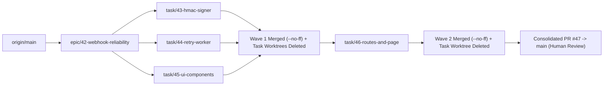

# End-to-End Architecture Walkthrough

This guide traces a complete, realistic 2-wave feature Epic from the developer's first prompt to the final consolidated Pull Request on `main`, showing every GitHub Issue contract, filesystem directory under `<parent>/.worktrees/<repo>/`, `wdd-worktree.sh` operation, crash-recovery state file, and review gate along the way.

- **Understand the "why" behind each invariant:** [Principles of Workflow-Driven Development](./principles.md)
- **Set up WDD in your harness first:** [Multi-Harness Installation & Quickstart Manual](./installation.md)

---

## Scenario Overview

Suppose you maintain `acme/payments-api` checked out locally at `/workspace/payments-api` on branch `main`. You need to build a complete **Outbound Webhook Reliability** subsystem comprising:

1. **HMAC-SHA256 webhook signature generation & verification middleware**;
2. **A database-backed exponential backoff retry worker & delivery ledger**;
3. **Dashboard UI components** (delivery log table + manual replay drawer); and
4. **End-to-end HTTP route wiring, dashboard page mounting, and full-stack integration tests**.

---

## Phase 1: Planning & Publishing the Epic (`wdd-create-epic`)

### Developer Prompt #1

Inside `/workspace/payments-api`, you give your agent a single planning prompt:

```text
/wdd-create-epic Plan and publish an Epic for outbound webhook HMAC-SHA256 signing, exponential backoff retries (max 5 attempts), and an admin delivery log + replay UI in acme/payments-api.
```

### What [`wdd-create-epic`](../skills/wdd-create-epic/SKILL.md) & [`wdd-create-task`](../skills/wdd-create-task/SKILL.md) Do

1. **Read-Only Discovery:** Inspects `/workspace/payments-api`, reads `AGENTS.md` (discovering a 300-line file limit, `npm test`, and `npx oxfmt`), and maps exact route registries and UI folders.
2. **Freezes Shared Contracts:** Defines the exact `X-Acme-Signature-256` header format (`t=<unix>,v1=<hex>`), the `webhook_deliveries` SQL schema, and the `WebhookDeliveryDTO` TypeScript shape verbatim inside the Epic.
3. **Builds the Wave DAG & File Isolation Matrix:** Notice that wiring HTTP routes (`src/routes/index.ts`) and mounting the full page (`web/pages/WebhooksPage.tsx`) depend on all three building blocks. Placing those shared integration touchpoints into **Wave 2** leaves **Wave 1** 100% disjoint across 3 parallel subagents:

| Issue | Wave | Title | Depends On | Exclusive Allowed Files |
| :--- | :--- | :--- | :--- | :--- |
| `#43` | **Wave 1** | `feat(webhooks): add HMAC-SHA256 signer and verification helper` | — | `src/webhooks/hmac.ts`, `src/webhooks/types.ts`, `tests/webhooks/hmac.test.ts` |
| `#44` | **Wave 1** | `feat(webhooks): add delivery ledger migration and backoff retry worker` | — | `db/migrations/0019_webhook_deliveries.sql`, `src/webhooks/ledgerRepo.ts`, `src/webhooks/retryWorker.ts`, `tests/webhooks/retryWorker.test.ts` |
| `#45` | **Wave 1** | `feat(ui): create webhook delivery table and replay drawer components` | — | `web/components/webhooks/DeliveryTable.tsx`, `web/components/webhooks/ReplayDrawer.tsx`, `web/components/webhooks/DeliveryTable.test.tsx` |
| `#46` | **Wave 2** | `feat(webhooks): wire replay API routes, dashboard page, and integration suite` | `#43, #44, #45` | `src/routes/webhooks.ts`, `src/routes/index.ts`, `web/pages/WebhooksPage.tsx`, `tests/integration/webhooksE2E.test.ts` |

### Why Wave 1 Cannot Collide

Verify the intersection across Wave 1's file sets:

$$\text{Files}(\#43) \cap \text{Files}(\#44) = \emptyset, \quad \text{Files}(\#44) \cap \text{Files}(\#45) = \emptyset, \quad \text{Files}(\#43) \cap \text{Files}(\#45) = \emptyset$$

Furthermore, [`wdd-create-task`](../skills/wdd-create-task/SKILL.md) embeds an explicit **Wave 1 Parallelism Rule** callout inside each issue body. For example, Issue `#43` warns its subagent:

> **Wave 1 Parallelism Rule:** Do **NOT** modify `db/migrations/**`, `src/webhooks/ledgerRepo.ts`, `src/webhooks/retryWorker.ts`, `web/components/webhooks/**`, or `src/routes/index.ts` — those files belong to sibling Wave 1 tasks (`#44`, `#45`) or downstream Wave 2 (`#46`).

`wdd-create-epic` publishes Epic `#42`, batch-creates `#43`, `#44`, `#45`, and `#46`, backfills their real `#ID` links into Epic `#42`, and hands you the Epic link for review.

---

## Phase 2: Coordinating Waves & Worktrees (`wdd-run-epic`)

### Developer Prompt #2

Once satisfied with Epic `#42`, you trigger autonomous execution:

```text
/wdd-run-epic #42
```

From this point forward, [`wdd-run-epic`](../skills/wdd-run-epic/SKILL.md) executes Wave 1 and Wave 2 continuously without pausing between waves unless one of the four safety stop gates triggers.



### Filesystem Lifecycle Under `<parent>/.worktrees/<repo>/`

Watch how `/workspace/` evolves across the four stages of the run. Notice that `/workspace/payments-api` (your primary checkout) is **never modified**.

#### Stage A — Before `/wdd-run-epic #42`

```text
/workspace/
└── payments-api/                                  # Your primary checkout (stays untouched on main)
```

#### Stage B — Epic Initialization & During Wave 1 (`#43 ∥ #44 ∥ #45`)

First, the Coordinator initializes the Epic worktree via [`wdd-worktree.sh`](../skills/wdd-run-epic/scripts/wdd-worktree.sh):

```bash
bash ~/.agents/skills/wdd-run-epic/scripts/wdd-worktree.sh \
  epic-init "/workspace/payments-api" "42" "webhook-reliability" "main"
```

Then it creates three Wave 1 task worktrees forked from `epic/42-webhook-reliability` and dispatches 3 parallel [`wdd-execute-task`](../skills/wdd-execute-task/SKILL.md) subagents in a single turn. Each subagent runs a fresh `npm ci` inside its own worktree (zero shared symlinks):

```text
/workspace/
├── payments-api/                                  # Primary checkout (untouched)
└── .worktrees/
    └── payments-api/
        ├── epic-42-webhook-reliability/           # Branch: epic/42-webhook-reliability
        │   └── .wdd/
        │       └── state.md                       # Local ledger (ignored via .git/info/exclude)
        ├── task-43-hmac-signer/                   # Branch: task/43-hmac-signer
        │   └── node_modules/                      # Fresh isolated install (no symlinks)
        ├── task-44-retry-worker/                  # Branch: task/44-retry-worker
        │   └── node_modules/                      # Fresh isolated install (no symlinks)
        └── task-45-ui-components/                 # Branch: task/45-ui-components
            └── node_modules/                      # Fresh isolated install (no symlinks)
```

#### Stage C — Coordinator Review, Scoped Fix, & Wave 1 Cleanup (`wdd-review-task`)

As each Wave 1 subagent returns its structured completion report, the Coordinator runs [`wdd-review-task`](../skills/wdd-review-task/SKILL.md) directly on `git diff epic/42-webhook-reliability...task/<id>-<slug>`:

- **Task `#43`:** Passes all 3 lenses (Spec Completeness, Wave File Isolation, `AGENTS.md` Rules) on Round 0. Merged and cleaned up immediately:
  ```bash
  bash ~/.agents/skills/wdd-run-epic/scripts/wdd-worktree.sh task-merge-and-clean \
    "/workspace/.worktrees/payments-api/epic-42-webhook-reliability" \
    "/workspace/.worktrees/payments-api/task-43-hmac-signer" \
    "task/43-hmac-signer" "1" "43" "add HMAC-SHA256 signer and verification helper"
  ```
- **Task `#44`:** During Lens 3 inspection, the Coordinator spots that `retryWorker.ts` skips clamping jitter when `attempt === 5`. Rather than patching code inline, the Coordinator dispatches a **Round 1 scoped fix subagent** inside the still-warm `task-44-retry-worker` worktree. The fix subagent adds the clamp + regression test, commits cleanly, passes re-review, and merges cleanly via `task-merge-and-clean`.
- **Task `#45`:** Passes all 3 lenses on Round 0 and merges cleanly via `task-merge-and-clean`.

Right between Wave 1 and Wave 2—after `git push origin epic/42-webhook-reliability`—all three temporary Wave 1 worktrees and `task/*` branches are already gone:

```text
/workspace/
├── payments-api/                                  # Primary checkout (untouched)
└── .worktrees/
    └── payments-api/
        └── epic-42-webhook-reliability/           # HEAD now contains #43, #44, and #45!
            └── .wdd/
                └── state.md                       # Wave 1 marked [x] with merge commit SHAs
```

Also between waves, `wdd-run-epic` checks off `- [x] Wave 1: #43, #44, #45` in Epic `#42` and posts a concise Wave 1 summary comment—keeping `#42`, `#43`, `#44`, and `#45` **OPEN**.

#### Stage D — Wave 2 Execution (`#46`) & Whole-Epic Integration Check

Next, `wdd-run-epic` forks `task-46-routes-and-page` from the **updated HEAD** of `epic/42-webhook-reliability`. Because Wave 1 is already merged there, `#46`'s subagent immediately sees `src/webhooks/hmac.ts`, `src/webhooks/retryWorker.ts`, and `web/components/webhooks/*` on disk!

Once `#46` passes `wdd-review-task` and `task-merge-and-clean` deletes `task-46-routes-and-page`, only the Epic worktree remains:

```text
/workspace/
├── payments-api/                                  # Primary checkout (untouched)
└── .worktrees/
    └── payments-api/
        └── epic-42-webhook-reliability/           # Contains Wave 1 + Wave 2; runs final npm ci + test + build
            ├── node_modules/                      # Installed for Whole-Epic Integration Gate
            └── .wdd/
                └── state.md                       # All waves marked [x]
```

---

## Phase 3: Seamless Crash & Context-Compaction Recovery (`.wdd/state.md`)

What happens if your laptop loses power, your terminal closes, or your AI harness compacts its conversation window right after Wave 1 finishes?

Because `.wdd/` is added to `.git/info/exclude` inside the git common directory, `<epic-worktree>/.wdd/state.md` persists cleanly on disk without ever dirtying `git status` or `.gitignore`:

```markdown
# WDD Epic Ledger — #42 (`epic/42-webhook-reliability`)

- Primary Repo: `acme/payments-api`
- Epic Branch: `epic/42-webhook-reliability`
- Epic Worktree: `/workspace/.worktrees/payments-api/epic-42-webhook-reliability`

## Waves
- [x] Wave 1: #43, #44, #45
- [ ] Wave 2: #46

## Task Log & Rulings
- Task #43: merged (`a18f2c0`, review clean after 0 fix rounds)
- Task #44: merged (`d94e11b`, review clean after 1 fix round — clamped max backoff jitter)
- Task #45: merged (`7c309ef`, review clean after 0 fix rounds)
```

When you re-run `/wdd-run-epic #42` in a brand-new session:
1. `wdd-worktree.sh epic-init` re-attaches idempotently to `/workspace/.worktrees/payments-api/epic-42-webhook-reliability`.
2. Step 1.4 of [`wdd-run-epic`](../skills/wdd-run-epic/SKILL.md) inspects `git log --oneline origin/main..HEAD` alongside `.wdd/state.md`, confirms `#43`, `#44`, and `#45` are already merged into `epic/42-webhook-reliability`, and **resumes directly at Wave 2 (`#46`)**—zero duplicate subagent runs and zero lost work.

---

## Phase 4: Consolidated Single-PR Delivery to `main`

After the Whole-Epic Integration Gate passes inside `epic-42-webhook-reliability` (`npm test`, `npm run build`, and `npx oxfmt --check` across `origin/main...HEAD`), `wdd-run-epic` opens **one consolidated Pull Request** from `epic/42-webhook-reliability` targeting `main`:

### Resulting Pull Request (`#47`: `feat(webhooks): outbound HMAC signing, retry queue, and delivery UI (#42)`)

```markdown
## Summary

Consolidated implementation of Epic #42 across 2 execution waves, adding HMAC-SHA256 outbound webhook signing, persistent exponential backoff retries, and the admin delivery log & manual replay UI.

Closes #42
Closes #43
Closes #44
Closes #45
Closes #46

---

## Wave Breakdown

| Wave | Task | Commit(s) | Summary |
| :--- | :--- | :--- | :--- |
| Wave 1 | #43 | `a18f2c0` | Add HMAC-SHA256 signer, timestamp tolerance check, and unit tests |
| Wave 1 | #44 | `d94e11b` | Add `webhook_deliveries` migration, ledger repo, and 5-attempt backoff worker |
| Wave 1 | #45 | `7c309ef` | Build `DeliveryTable` and `ReplayDrawer` UI components with component tests |
| Wave 2 | #46 | `5f02b8a` | Wire `/api/webhooks/*` routes, mount `WebhooksPage`, and add E2E suite |

---

## Verification & Quality Gate

- **Automated Tests:** `npm test` → `42 passed, 0 failed` (100% green across unit, component, and E2E suites)
- **Formatting & Lint:** `npx oxfmt --check` & `npm run lint` → `clean (0 errors)`
- **Build / Types:** `npm run build && npm run typecheck` → `succeeded`

## Notes & Conscious Follow-Ups

- Configure `WEBHOOK_SIGNING_SECRET` in staging/production secret managers before enabling outbound webhook endpoints.
```

Finally, `wdd-run-epic`:
1. Posts a closing summary comment on Epic `#42` linking to PR `#47` while keeping `#42`–`#46` **OPEN**;
2. **Never executes `gh pr merge`**—handing you the PR `#47` URL so a human makes the final production merge decision; and
3. Lets GitHub atomically close `#42`, `#43`, `#44`, `#45`, and `#46` the moment PR `#47` merges into `main`.
