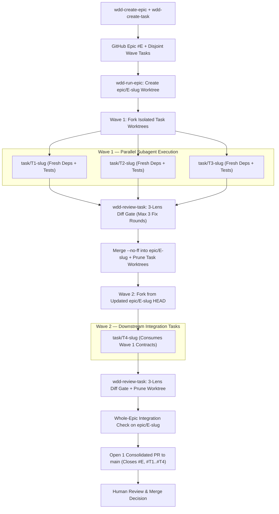
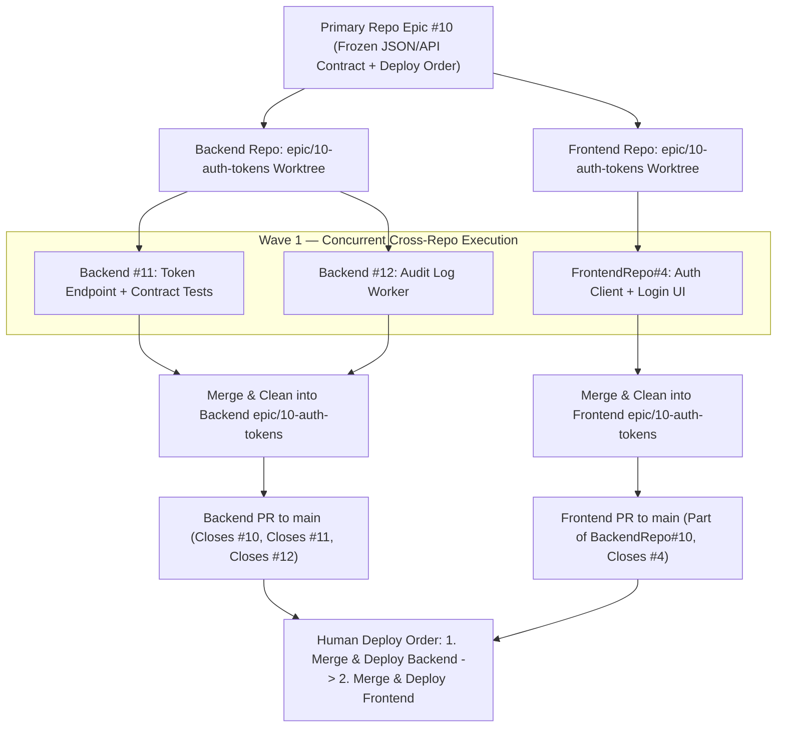
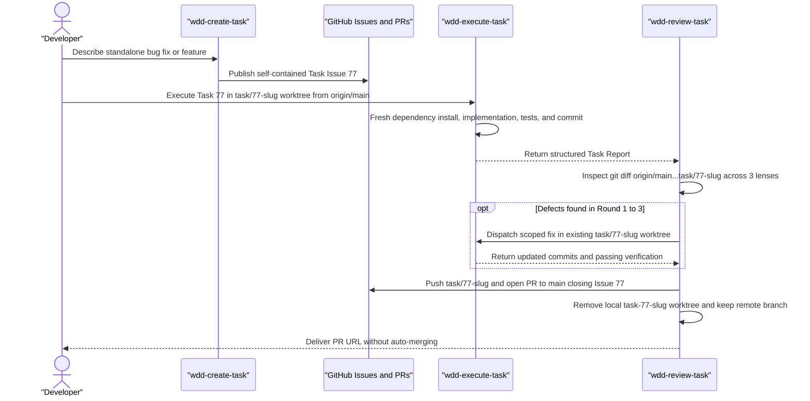

# Principles of Workflow-Driven Development (WDD)

**Workflow-Driven Development (WDD)** is an architectural pattern and multi-skill coordination protocol for scaling AI software engineering across parallel subagents without merge conflicts, context rot, shared-dependency race conditions, or premature production deployments.

Instead of treating multi-agent coding as an unstructured chat session or an ad-hoc swarm, WDD models feature delivery as a deterministic pipeline: **frozen GitHub Issue contracts**, **zero-overlap task waves**, **isolated `git worktree` execution environments**, **direct coordinator diff gates**, and **human-gated single-PR delivery**.

- **Ready to install?** See the [Multi-Harness Installation & Quickstart Manual](./installation.md).
- **Want to see it in action?** Read the [End-to-End Architecture Walkthrough](./architecture-walkthrough.md).

---

## 1. The Problem with Unstructured Multi-Agent Coding

Modern AI coding harnesses make it trivial to spawn three, five, or ten subagents simultaneously. Without structural invariants, however, adding more agents routinely *slows delivery down* due to five recurring failure modes:

### 1.1 Merge Conflicts on Shared Files
When parallel subagents implement sibling features simultaneously from the same base commit, they inevitably touch shared choke points—HTTP route registries (`routes/web.php`, `src/routes/index.ts`), core domain models (`User`, `Order`), database schema files, barrel exports (`index.ts`), or global stylesheets. Reconciling semantic merge conflicts across machine-generated branches often takes longer than writing the feature sequentially.

### 1.2 Context Window Rot & Hallucinated State
Executing a 10-task initiative sequentially inside a single long-lived agent session fills the context window with stale file reads, superseded compiler errors, and abandoned experiments. By Task 7, instruction adherence degrades, earlier repository rules (`AGENTS.md` / `CLAUDE.md`) slip out of attention, and the model begins hallucinating method signatures or skipping edge-case tests.

### 1.3 Shared Dependency & Codegen Race Conditions
To save disk space or setup time, multi-worktree setups frequently symlink a single `node_modules/`, `vendor/`, or `.venv/` directory across parallel worker checkouts. As soon as two concurrent subagents run Composer autoload dumps, Prisma/ORM client generators, Vite/TypeScript build caches, or Laravel Wayfinder route generation at the same time, they overwrite each other's generated artifacts mid-test—causing flaky, non-reproducible failures.

### 1.4 Premature Production Deployments on `main`
Many teams run continuous deployment pipelines where every merge into `main` automatically ships to staging or production. If an agent workflow merges Task 1 (database migration + internal service) directly into `main` before Task 2 (API endpoint) and Task 3 (frontend consumer) are ready—or worse, merges half of Wave 1 before discovering a contract mismatch in Wave 2—unfinished features leak into production.

### 1.5 Orphaned Worktrees & Branch Sprawl
Ad-hoc worktree workflows routinely leave behind dozens of unpruned directories, locked `.git/worktrees/*` metadata entries, uncommitted scratch files, and stale `feat/*` branches whenever an agent crashes, hits a token limit, or finishes a review round.

---

## 2. The 7 Core Principles of WDD

Workflow-Driven Development eliminates each failure mode above through seven non-negotiable invariants enforced across [`wdd-create-epic`](../skills/wdd-create-epic/SKILL.md), [`wdd-create-task`](../skills/wdd-create-task/SKILL.md), [`wdd-run-epic`](../skills/wdd-run-epic/SKILL.md), [`wdd-execute-task`](../skills/wdd-execute-task/SKILL.md), and [`wdd-review-task`](../skills/wdd-review-task/SKILL.md).

### Principle 1: GitHub Issues as Self-Contained Contracts
Chat history is ephemeral; GitHub Issues are durable, inspectable specifications.
- **Epics are Flight Manuals:** Created by [`wdd-create-epic`](../skills/wdd-create-epic/SKILL.md), the Epic issue freezes shared architectural decisions, exact DTO/JSON/SQL contracts, out-of-scope boundaries, the Wave DAG, and the File Isolation Matrix.
- **Tasks Require Zero Chat Context (`flash`-Ready by Construction):** Created by [`wdd-create-task`](../skills/wdd-create-task/SKILL.md), every child Task issue contains exact file paths, concrete method signatures, HTTP status codes, UI states, allowed files, forbidden parallel-wave files, mandatory test scenarios, and exact verification commands. Because architectural reasoning is already solved upfront, WDD defaults subagent execution (and read-only discovery) to the fast, cost-effective **`flash` model tier** whenever the user has not requested a heavier model—while an isolated subagent running [`wdd-execute-task`](../skills/wdd-execute-task/SKILL.md) reads only `gh issue view <id>` and `AGENTS.md`.

### Principle 2: Surgical Wave DAGs & Zero File-Overlap Matrices
Parallelism is planned at architecture time, never improvised at merge time.
- Work is partitioned into sequential waves (`Wave 1` → `Wave 2` → ... → `Wave K`), while tasks inside the same wave run concurrently.
- **Strict Disjointness Invariant:** For any two tasks $A$ and $B$ scheduled in the same `(Wave, Repository)` pair:
  $$\text{FileSet}(A) \cap \text{FileSet}(B) = \emptyset$$
- Whenever two tasks need to touch the same route file, model, enum, or barrel export, the architect resolves the overlap *before* publishing issues by:
  1. Extracting the shared contract or schema into an earlier foundational wave;
  2. Sequencing Task $B$ into the next wave (`Depends on: #A`); or
  3. Combining tightly coupled edits into a single cohesive task within repository file-size guardrails.

### Principle 3: Dedicated Epic Integration Branches (`epic/<id>-<slug>`)
Intermediate waves never target `main`.
- When [`wdd-run-epic`](../skills/wdd-run-epic/SKILL.md) starts, it creates a dedicated integration branch `epic/<epic-id>-<slug>` branched off `origin/main`.
- Every approved task in `Wave N` merges (`git merge --no-ff`) into `epic/<epic-id>-<slug>`.
- When `Wave N+1` begins, its task branches fork from the **updated HEAD** of `epic/<epic-id>-<slug>`, gaining immediate access to `Wave N`'s code while `main` remains completely untouched and deploy-safe.

### Principle 4: Full Worktree & Dependency Isolation (Zero Symlinks)
Every unit of concurrent work receives its own filesystem sandbox and dependency tree.
- WDD places all managed checkouts in a sibling directory outside the user's primary working tree:
  - Epic worktree: `<parent>/.worktrees/<repo>/epic-<epic-id>-<slug>`
  - Task worktree: `<parent>/.worktrees/<repo>/task-<task-id>-<slug>`
- Your primary repository checkout stays clean and usable while an Epic runs in the background.
- **Zero Shared Symlinks:** Each `<task-worktree>` installs its dependencies cleanly from scratch (`npm ci`, `composer install`, `uv sync`, `cargo check`, etc.) and never symlinks `node_modules/`, `vendor/`, or `.venv/` from another directory. Parallel code generators, typecheckers, and test databases cannot race or corrupt one another.

### Principle 5: Direct Coordinator Diff Gate & Bounded 3-Round Fix Loop
Subagent self-reports ("All tests pass!") are never trusted blindly, and Coordinator context is never wasted patching code inline.
- When a task subagent finishes, the Coordinator executes [`wdd-review-task`](../skills/wdd-review-task/SKILL.md) directly over `git diff <base-ref>...task/<id>-<slug>`—without spawning a separate reviewer subagent seat.
- Every diff is evaluated across **three mandatory lenses**:
  1. **Spec & Contract Completeness:** Every acceptance criterion, edge case, and non-tautological automated test required by `#<task-id>` is present.
  2. **Wave File Isolation & Diff Hygiene:** Zero edits to files reserved for parallel sibling tasks, and zero stray `.env`, `.sqlite`, or debug artifacts.
  3. **Repository Rules (`AGENTS.md` / `CLAUDE.md`):** File/method line-count ceilings, required code formatters, static analysis, and security/authorization boundaries are satisfied.
- **Bounded 3-Round Circuit Breaker:** If any lens fails, the Coordinator never edits code itself; instead, it dispatches a scoped fix subagent inside the *existing* `<task-worktree>` (where dependencies are already installed) with exact `file:line` findings. If a task still fails after **3 fix rounds**, the circuit breaker trips, preserves `<task-worktree>` for inspection, records the diagnosis in `.wdd/state.md`, and escalates cleanly to the human.

### Principle 6: Immediate Ephemeral Cleanup
Temporary workspaces live only as long as the task they execute.
- The moment a task passes review in Epic mode, `wdd-worktree.sh task-merge-and-clean` merges `task/<id>-<slug>` into `epic/<epic-id>-<slug>`, unlocks and removes `<task-worktree>`, runs `git worktree prune`, and deletes the temporary `task/<id>-<slug>` branch locally and on `origin` if pushed.
- Even on a 15-task Epic, disk usage is bounded by the width of a **single active wave**, not the total number of tasks in the Epic.

### Principle 7: Human-Gated Single-PR Delivery
Autonomous execution stops at Pull Request creation—humans own `main`.
- **Issues Stay Open During Execution:** As waves complete, [`wdd-run-epic`](../skills/wdd-run-epic/SKILL.md) checks off wave items in the Epic body, updates `<epic-worktree>/.wdd/state.md` (hidden via `.git/info/exclude`), and posts concise wave-summary comments—leaving the Epic and child Task issues **OPEN**.
- **Whole-Epic Integration Gate:** After the final wave lands on `epic/<epic-id>-<slug>`, the Coordinator installs clean dependencies in `<epic-worktree>` and runs cross-wave tests, formatters, and builds across `origin/main...HEAD`.
- **One Consolidated PR per Repository:** WDD opens a single Pull Request from `epic/<epic-id>-<slug>` into `main` containing `Closes #<epic-id>` and `Closes #<task-1..N>`. GitHub automatically closes the Epic and all child Tasks atomically only when a human reviews and merges the PR. WDD **never** runs `gh pr merge` on `main`.

---

## 3. Architectural Comparison Matrix

| Dimension | Single-Agent Sequential | Uncoordinated Agent Swarm | Stacked Per-Task PRs | Workflow-Driven Development (WDD) |
| :--- | :--- | :--- | :--- | :--- |
| **Execution Speed** | Slow ($O(N)$ serial execution) | Fast burst, heavy rework | Moderate (blocked on serial PR rebases) | Fast ($O(K)$ waves, parallel within each wave) |
| **Merge Conflicts** | None (single thread) | Frequent on routes, models, barrels | Cascading rebase churn when base PR changes | **Near-zero** via upfront File Isolation Matrix |
| **Context Window Health** | Degrades across tasks (context rot) | Fresh per worker, but specs drift | Fresh per PR, high orchestration chatter | **Fresh per task** + lean Coordinator ledger |
| **Dependency / Codegen Safety** | Safe (single checkout) | Race-prone if `vendor/` / `node_modules/` shared | Safe only if isolated per branch | **Guaranteed** (clean install per task worktree) |
| **Main Branch CI/CD Safety** | Safe if 1 PR; risky if committing to `main` | Unsafe if workers push/merge piecemeal | High CI runner burn across $N$ stacked PRs | **Protected** (`epic/*` absorbs waves; 1 final PR to `main`) |
| **Human Review Overhead** | 1 large unstructured diff | Chaotic multi-branch triage | $N$ separate PR reviews & merge clicks | **1 structured PR** pre-vetted by 3-lens task gates |
| **Crash / Compaction Recovery** | Fragile (relies on chat transcript) | Manual forensics across leftover branches | Tracked via open PR stack | **Deterministic** (`git log` on `epic/*` + `.wdd/state.md`) |

---

## 4. Execution Topologies

WDD supports three primary topologies using the exact same five skills.

### 4.1 Single-Repository Multi-Wave Epic Flow

The standard topology for medium-to-large features, refactors, and multi-layer initiatives inside one repository:

### 4.2 Cross-Repository Epic Flow

When an initiative spans multiple repositories (for example, a backend API repository and a separate web or mobile client repository), [`wdd-create-epic`](../skills/wdd-create-epic/SKILL.md) hosts the Epic in the **primary repository**, freezes the exact HTTP/JSON/event contracts verbatim in both repositories' Task issues, and specifies the mandatory **production merge and deploy order**.

Tasks in different repositories can execute **in parallel within the same wave** because their files live in separate git repositories and their shared wire contract is already frozen:

### 4.3 Standalone Single-Task Flow (No Parent Epic)

Not every change needs a multi-wave Epic. For a focused bug fix or self-contained single-task enhancement, WDD runs a lightweight 3-step pipeline directly from `origin/main` without creating an `epic/*` branch:

---

## 5. Trade-Offs & When to Use WDD

WDD deliberately trades **upfront specification rigor and temporary disk bandwidth** in exchange for **deterministic parallel execution and clean reviewability**:

| Trade-Off | Cost | Payoff |
| :--- | :--- | :--- |
| **Upfront Issue Authoring** | Spending 3–8 minutes grounding file paths, freezing schemas, and verifying the File Isolation Matrix before writing code. | Subagents execute without ambiguity, halting mid-wave redesigns and cross-task merge conflicts. |
| **Fresh Dependencies per Task Worktree** | Installing `node_modules/` or `vendor/` inside each active wave's worktrees uses temporary disk I/O and space during the wave. | Eliminates parallel codegen/autoloader corruption; disk space is reclaimed immediately when each task merges. |
| **Strict Wave Barriers** | `Wave N+1` waits for all `Wave N` tasks in the same dependency chain to pass review and merge into `epic/<id>-<slug>`. | Downstream tasks always branch from verified, test-passing code rather than speculative in-flight branches. |

### Practical Sizing Guide

- **Trivial 1–2 file edit (< 15 minutes, clear scope):** Edit directly in your normal agent session—no WDD overhead required.
- **Focused bug fix or isolated single-slice feature (2–6 files, 1 PR):** Use **Standalone Task Mode** ([`wdd-create-task`](../skills/wdd-create-task/SKILL.md) → [`wdd-execute-task`](../skills/wdd-execute-task/SKILL.md) → [`wdd-review-task`](../skills/wdd-review-task/SKILL.md)).
- **Multi-layer feature, refactor, or cross-repo initiative (3+ tasks, shared contracts, multiple subsystems):** Use the **Full Epic Workflow** ([`wdd-create-epic`](../skills/wdd-create-epic/SKILL.md) → [`wdd-run-epic`](../skills/wdd-run-epic/SKILL.md)).
